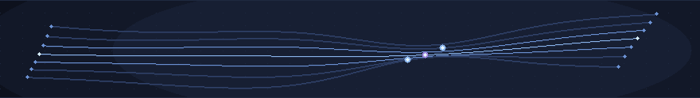

# Cognitive Wiring Core



[](https://github.com/neuron7x/sapolsky-behave-layers/actions/workflows/cwc-wp4-replay.yml)
[](https://github.com/neuron7x/sapolsky-behave-layers/actions/workflows/cwc-documentation-audit.yml)
[](LICENSE)

Can a system keep competing explanations in play, ask for evidence that could
change its decision, and stay within the comparator budget?

## Run on GitHub

| Start here | What it runs |
| --- | --- |
| [Replay WP4](https://github.com/neuron7x/sapolsky-behave-layers/actions/workflows/cwc-wp4-replay.yml) | Check the frozen archive and replay the eight-seed synthetic result on CPU. Download the log and checkout receipt from the run. |
| [Full verification](https://github.com/neuron7x/sapolsky-behave-layers/actions/workflows/cwc-full-pr-gate.yml) | Run the repository's CPU verification, including tests, evidence checks and falsification gates. |

Open **Actions → WP4 replay** (or **cwc-full-pr-gate**) → **Run workflow**.
If you have read-only access here, [fork the repository](https://github.com/neuron7x/sapolsky-behave-layers/fork),
enable Actions on your fork and run it there. GitHub requires write access
to start a run. [GitHub instructions](https://docs.github.com/en/actions/how-tos/manage-workflow-runs/manually-run-a-workflow)

<details>
<summary>Replay from a terminal</summary>

Requires Git, GNU Make, Python 3.11, `sha256sum` and
[`uv`](https://docs.astral.sh/uv/getting-started/installation/).

```bash
git clone https://github.com/neuron7x/sapolsky-behave-layers.git
cd sapolsky-behave-layers
uv sync --frozen --extra cpu --python 3.11
make -f Makefile.cwc reproduce-primary
```

[Full terminal setup and commands](docs/vnv/CWC_TEST_AND_CI_REFERENCE.md)

</details>

## Results

- **WP4 verified a synthetic identity.** With a free exact halt oracle, the
  solved-rate gap is `P_sample(m>K)`. The archived static budget rounds the
  adaptive mean, so exact compute parity remains outside this result.
  [WP4 evidence](artifacts/wp4-adaptive-depth/) · [Interpretation](docs/vnv/EPISTEMIC_CORRECTION_WP4_2026-07-19.md)
- **Learned two-exit adaptive depth** ended as `NOT_SUPPORTED`.
  [Programme decision](docs/vnv/CWC_PROGRAM_DECISION_2026-08-11.md)
- **External transfer** remains `NOT_TESTED`.
  [REAL-TRANSFER-01](experiments/real_transfer_01/PREREGISTRATION.md)

[System map](SYSTEM.md) · [Architecture](docs/architecture/CWC_ARCHITECTURE.md) ·
[Claim registry](claim_registry.json) · [Documentation audit](docs/assurance/DOCUMENTATION_AUDIT.md) ·
[DGC evidence and replay](docs/DGC_PRODUCT_EXECUTION_RUNBOOK_v1.md) ·
[Research history](https://github.com/neuron7x/sapolsky-behave-layers/blob/033e5d470573c9818a20ea3dc4b48c7289ac566d/README.md)

CWC by Yaroslav Vasylenko. Built on [Andrej Karpathy’s nanochat](https://github.com/karpathy/nanochat).
[Citation](CITATION.cff) · [Third-party notices](THIRD_PARTY_NOTICES.md)
