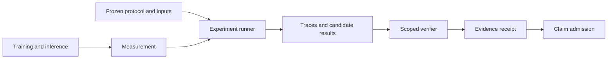

# Cognitive Wiring Core architecture

Implementation baseline: [`861718751198deeeda54a23efacb2227a819b49f`](https://github.com/neuron7x/sapolsky-behave-layers/commit/861718751198deeeda54a23efacb2227a819b49f), tree `1386cbc5cb9f1c93f38665671b21745cf3a7b0f1`. [SYSTEM](../../SYSTEM.md) maps the programme. [The closure charter](../../CWC_CLOSURE.md) defines the current scientific critical path.

## Execution and evidence boundaries

The arrows describe data and authority flow across the repository. Each experiment chooses its own runner and verifier. A receipt licenses only the conclusion named by its contract.

| Area | Implemented boundary and observable behavior |
| --- | --- |
| `nanochat/` and model scripts | The upstream-derived CLI loads a tokenizer and model, then streams from the engine. The engine checks requests before KV allocation and logits before sampling. Checkpoint load checks the tensor manifest when present, retaining support for legacy checkpoints. [CLI](https://github.com/neuron7x/sapolsky-behave-layers/blob/861718751198deeeda54a23efacb2227a819b49f/scripts/chat_cli.py#L13-L35) · [engine](https://github.com/neuron7x/sapolsky-behave-layers/blob/861718751198deeeda54a23efacb2227a819b49f/nanochat/engine.py#L166-L224) · [checkpoint](https://github.com/neuron7x/sapolsky-behave-layers/blob/861718751198deeeda54a23efacb2227a819b49f/nanochat/checkpoint_manager.py#L41-L123). |
| `cwc/instrumentation/` | Immutable OFF, COUNTERS, TRACE and AUDIT settings configure measurement. The run meter batches CUDA synchronization. The writer records JSONL and hashes files. Buffer flushing precedes hashing by caller contract. [Config](https://github.com/neuron7x/sapolsky-behave-layers/blob/861718751198deeeda54a23efacb2227a819b49f/cwc/instrumentation/config.py#L16-L49) · [meter](https://github.com/neuron7x/sapolsky-behave-layers/blob/861718751198deeeda54a23efacb2227a819b49f/cwc/instrumentation/run_meter.py#L56-L116) · [writer](https://github.com/neuron7x/sapolsky-behave-layers/blob/861718751198deeeda54a23efacb2227a819b49f/cwc/instrumentation/writer.py#L79-L98). |
| `cwc/causal/`, `counterfactual/`, `credit/`, `replay/`, `benchmarks/`, `plasticity/` | Causal models and interventions, counterfactuals, credit, replay, benchmark authority and plasticity are separate research packages. The contract tests selected import boundaries. Experiment protocols determine the scope of causal inference. [Package tree](../../cwc/) · [import constraints](../../engineering/architecture_contract.json) · [validation record](../vnv/VALIDATION_RECORD.md). |
| `cwc/epistemics/`, `memory/`, `planning/`, `inference/` | Typed evidence controls epistemic transitions. Memory holds evidence and provenance. Planning can return an action, an information request, abstention or blocked authority. Inference contains trace, abstention and shadow interfaces. [Epistemic states](https://github.com/neuron7x/sapolsky-behave-layers/blob/861718751198deeeda54a23efacb2227a819b49f/cwc/epistemics/lattice.py#L15-L76) · [memory](../../cwc/memory/epistemic_store.py) · [plans](https://github.com/neuron7x/sapolsky-behave-layers/blob/861718751198deeeda54a23efacb2227a819b49f/cwc/planning/proof_carrying.py#L18-L63) · [inference](../../cwc/inference/). |
| `cwc/evidence/`, `assurance/`, `research_ops/`, `governance/` | Evidence intake, engineering assurance, research operations and governance have distinct responsibilities. The DGC estimator summarizes regret over declared perturbations. DGC release construction requires a separate qualification graph for product authority. [Evidence intake](../../cwc/evidence/intake.py) · [research operations](../../cwc/research_ops/) · [DGC estimator](https://github.com/neuron7x/sapolsky-behave-layers/blob/861718751198deeeda54a23efacb2227a819b49f/cwc/governance/decision_gradient.py#L29-L85) · [DGC release](https://github.com/neuron7x/sapolsky-behave-layers/blob/861718751198deeeda54a23efacb2227a819b49f/scripts/make_dgc_release.py#L143-L202). |
| `experiments/`, `research/`, `artifacts/` | Experiment directories bind protocol, implementation and panel. Research materials and immutable evidence retain negative findings. Read scope and status from the protocol, registry and exact receipt. [Experiment ledger](../lab/EXPERIMENT_LEDGER.jsonl) · [claim registry](../../claim_registry.json) · [evidence directory](../../artifacts/). |
| `scripts/`, `tests/`, `.github/workflows/`, `engineering/`, `schemas/` | Operational entry points, test suites, hosted execution, engineering constraints and artifact schemas. Coverage depends on the selected target and measured package set. [Test and CI reference](../vnv/CWC_TEST_AND_CI_REFERENCE.md). |

## Three paths to follow in code

**CNEH-JOINT-LP-01.** A synthetic record and reference profile compile to an exact rational outer system. A bounded solver proposes multipliers. The checker rebuilds the system, checks the exact objective and proof, then returns an outer interval, certified exclusion or the full prior when required. The hosted workflow binds replay and aggregation to head, base, checkout and attempt. Physical existence requires separate admissible evidence. [Search](https://github.com/neuron7x/sapolsky-behave-layers/blob/861718751198deeeda54a23efacb2227a819b49f/experiments/cneh_joint_lp/search.py#L111-L154) · [checker](https://github.com/neuron7x/sapolsky-behave-layers/blob/861718751198deeeda54a23efacb2227a819b49f/experiments/cneh_joint_lp/kernel.py#L91-L125) · [receipt](https://github.com/neuron7x/sapolsky-behave-layers/blob/861718751198deeeda54a23efacb2227a819b49f/experiments/cneh_joint_lp/kernel.py#L271-L295) · [formal model](FORMAL_MODEL.md).

**REAL-TRANSFER-01.** Byte reconstruction, linked-source custody, repository collision audit and the inert source-manifest candidate precede source admission. The next dependencies are model and runner identities, six comparator implementations, CALIBRATION-only freezing, PRIMARY and conditional REPLICATION. The scientific result remains `NOT_TESTED` at this baseline. [Closure contract](../../CWC_CLOSURE.md) · [source-manifest candidate protocol](../../experiments/cwc_manifest_candidate/PROTOCOL.md) · [readiness](../../experiments/real_transfer_01/readiness.py).

**DGC product qualification.** The external verifier checks semantic replay. Product qualification, release packaging and production activation each carry distinct predicates. The tracked qualification pointer keeps product and production authority false. [External verifier](https://github.com/neuron7x/sapolsky-behave-layers/blob/861718751198deeeda54a23efacb2227a819b49f/scripts/dgc_external_p19_verifier.py#L13-L66) · [qualification pointer](../../artifacts/dgc-product-v1/PRODUCT_QUALIFICATION_POINTER_V3.json).

## Evidence to retain for changes

Record each changed interface, its input and output, a failure case the test must catch, and the Git tree tested. For claim-affecting changes, bind the protocol revision, assumptions, population, resource accounting, raw artifact digest and verdict. Treat import-boundary checks as checks of the declared import rules. Scientific validation follows the frozen endpoints. [Methodology](../methodology/CWC_MASTER_METHODOLOGY.md) · [requirements traceability](../vnv/REQUIREMENTS_TRACEABILITY_MATRIX.csv) · [source-to-obligation bibliography](../publication/SOURCE_TO_OBLIGATION.md).
